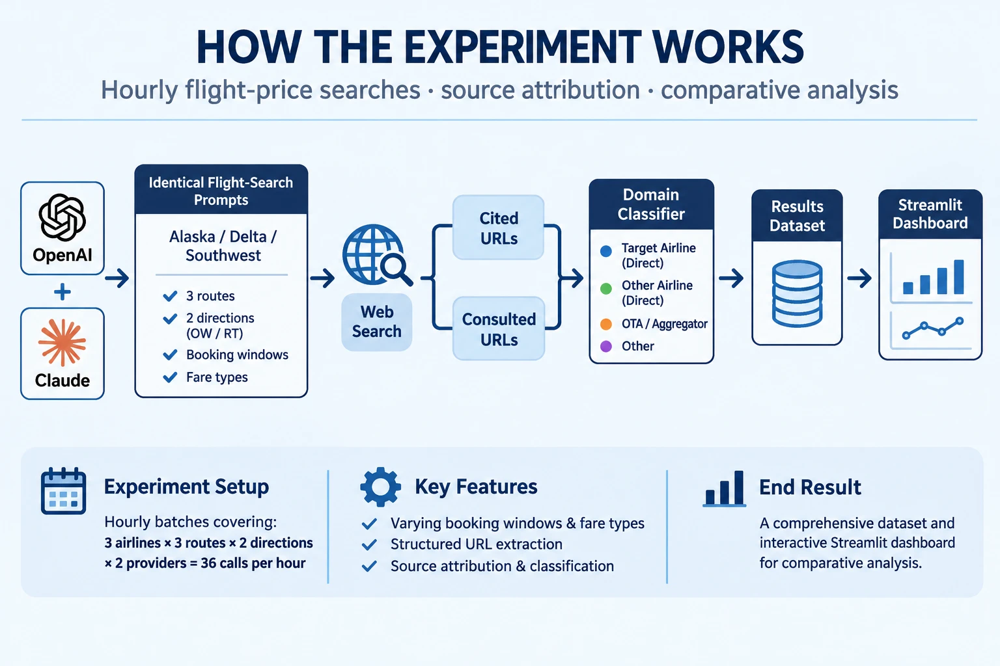

# icey-airlines: where do AI agents source flight prices?

Scheduled experiment: ask Claude and OpenAI (both with web search) for flight prices on Alaska, Delta and
Southwest routes, and record which websites they actually use (airline sites vs. OTAs/aggregators).
Sources come from **structured API fields** (search queries, result URLs, cited URLs), not from the model
describing itself. The model's own `SOURCES:` line is stored separately as a cross-check.

Caveat: the API with web search is not identical to the consumer ChatGPT/Claude apps. Read results as "how
the models search and source flight prices", not exactly what end users see. No bookings are made.

### Live dashboard: [icey-airlines.streamlit.app](https://icey-airlines.streamlit.app/)



## Layout
- `config/settings.yaml` models, caps, rotation settings (change models here, not in code)
- `config/routes.yaml` routes per airline (**drafts, not verified**; Southwest list is my own guess)
- `config/domains.yaml` domain → category map (`airline_direct_target`, `airline_direct_other`, `ota_aggregator`, `other`)
- `app.py` Streamlit dashboard (flight-deck theme in `.streamlit/config.toml`, images in `assets/`)
- `scripts/make_assets.py` regenerates the PNGs in `assets/` (banner, per-airline route maps, icon; needs `pip install matplotlib`)
- `src/run.py` builds the batch, calls APIs, appends rows to `data/results.jsonl`
- `src/providers.py` Anthropic + OpenAI wrappers and URL extraction · `src/classify.py` domain classification
- `.github/workflows/run_experiment.yml` manual "Run workflow" + external trigger (no GitHub cron)

## Design
- Each batch: 3 airlines × 3 routes × 2 directions × 2 providers = **36 calls** (cap: 40).
- Routes advance 3 per run per airline; window / fare / add-on follow a deterministic rotation over 27 combos
  keyed on the run number. Both directions and both providers get the identical prompt variables.
- Base prompt never names the airline (tests whether the agent picks it). From Nov 8 `prompt_variant: alternate`: even
  run numbers keep the base prompt, odd ones add "with <Airline>". Analysis, dashboard and H3-H5 use base only by
  default; H6 in `scripts/hypotheses.py` compares the two variants over the period they ran side by side.
- Test runs (`--test` / manual run with "test" checked) are flagged `is_test` and excluded from analysis.
- Known confound: Alaska (West Coast/Alaska), Delta (Atlanta/East), Southwest (hub-to-hub) are different markets.

## Local commands (no API keys needed)
```
python -m src.run --dry-run                  # show the next run's prompts
python -m src.run --dry-run --run-number 12  # preview any run
python -m src.run --check-rotation 72        # balance of the rotation over 72 runs
python -m unittest discover -s tests -t .
python -m src.classify data/results.jsonl    # category counts, top domains, unknown domains
python scripts/hypotheses.py                 # pre-specified follow-up tests (cluster bootstrap by batch, Holm)
```

## GitHub setup
1. Secrets (Settings → Secrets and variables → Actions → Secrets): `ANTHROPIC_API_KEY`, `OPENAI_API_KEY`.
2. Run the first test from the Actions tab: **Run experiment → Run workflow** (leave test = true, limit = 12).
3. Scheduled runs: GitHub's own cron fired too irregularly here, so the workflow has **no `schedule`**. A cron-job.org job
   calls the GitHub API (`workflow_dispatch`) on a schedule (minute 7; hourly at first, every 3 hours from Nov 8) with body
   `{"ref":"main","inputs":{"is_test":"false","batches":"1"}}` and a fine-grained token (Actions: read/write on this repo only).
   To pause: disable that cronjob. Revoke the token when the experiment ends.
   Manual catch-up: Run workflow with `is_test` off and `batches` up to 8 (36 calls each).

## Analysis and dashboard
```
python -m src.analyze                  # summary + z-tests; add --include-tests to count test runs
streamlit run app.py                   # local dashboard
```
Deploy on Streamlit Community Cloud (share.streamlit.io): New app → repo `carlosfg97/icey-airlines`, branch `main`,
main file `app.py`. Choose "Only specific people can view this app" in the sharing settings, since the repo is private
and the data should not be public. The app re-reads `data/results.jsonl` (cached 5 min) each time the repo updates.

The dashboard uses a navy/blue look inspired by the airline industry (independent research, not affiliated with any airline).
Chart colors were checked with the dataviz palette validator: blue = the airline's own site, orange = OTA/aggregator,
grays = other airlines and everything else.

Metrics use two URL sets: **cited** (in the answer) and **consulted** (everything the search returned). "Absence" is a text
heuristic (the answer never mentions the target airline), so treat it as approximate.
